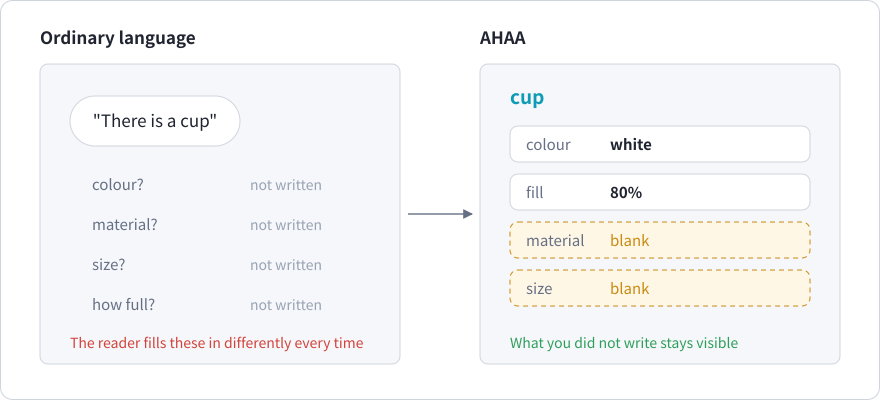
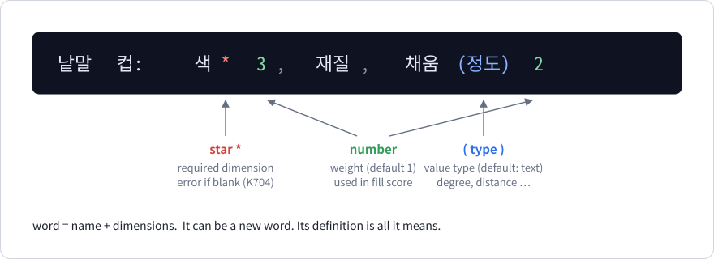
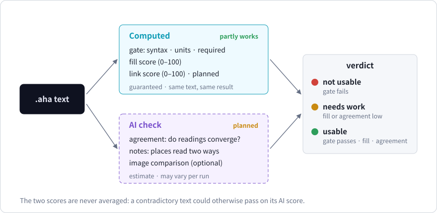
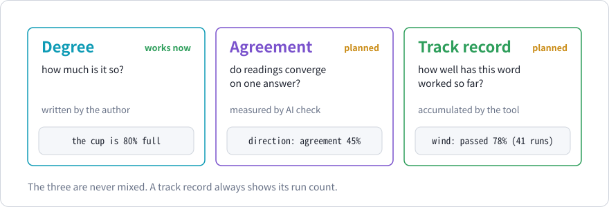
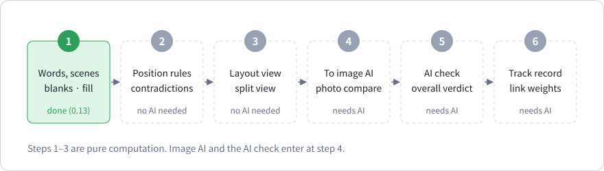

# Chapter 1. What AHAA is

> In this chapter
> - Why a word is not enough when the reader is an AI
> - A word as a bundle of dimensions, and the blank
> - The three things AHAA does, and the three numbers it keeps apart
> - What exists today and what is only planned

*Corresponds to chapter 1 of the Korean edition.*

## 1.1 A word omits most of what it means

Say "there is a cup". What colour is it? What is it made of? How large, how full? The sentence does not say. Ordinary language leaves most of a word unsaid and relies on the listener to fill it in from context. That is why speech can be short.



When the reader is a machine this becomes a problem. Tell an image model "there is a cup" and it invents a colour and a size, differently each time. The larger problem is on the writer's side: **you do not notice what you left out.**

Natural language was shaped for people talking to people who can see the same world. AHAA does not replace it and does not claim that AI models understand a new notation better. It adds a structure on top of ordinary writing that makes omissions visible.

## 1.2 A word is a bundle of dimensions

In AHAA you define a word by listing its dimensions.



```aha
낱말 컵: 색* 3, 재질, 채움(정도) 2

장면 방
  컵: 색 흰색
```

| Korean | English |
| --- | --- |
| `낱말 컵: 색* 3, 재질, 채움(정도) 2` | word `cup`: `colour` (required, weight 3), `material`, `fill` (a degree, weight 2) |
| `장면 방` | scene `room` |
| `컵: 색 흰색` | cup: colour white |

```text
장면 '방': 낱말 1개, 채움 50% (빈칸 2개: 컵.재질, 컵.채움)
```

The compiler answers: scene `room`, 1 word, **fill 50%**, 2 blanks: `cup.material` and `cup.fill`. You wrote only the colour. The material and the fill level did not vanish; they are listed as **blanks**.

A blank is not an error. Nobody can write everything. What matters is knowing what you did not write, and deciding on purpose.

## 1.3 Write, connect, get checked

AHAA does three things.

| Activity | What you do | Example |
| --- | --- | --- |
| **Write** | Say what there is: words, dimensions, values, units | `컵: 색 흰색` (cup: colour white) |
| **Connect** | Say what happens between them: who, what, when, how much, what causes what | `컵이 70% 떨어졌다` (the cup fell, degree 70%) |
| **Get checked** | Let a program verify the text | fill score, contradictions, connectivity |

AHAA is a **declarative** language. A file does not say what to do step by step. It states what is the case, and the compiler checks whether the statements are well-formed and consistent. SQL, HTML and the constraint languages used in verification are declarative in the same sense.

## 1.4 Two checks



| | Computed check | AI check |
| --- | --- | --- |
| How | Rules and arithmetic | An AI model reads the text several times |
| Result | A guarantee: same text, same result | An estimate that can vary between runs |
| Status | Works today | Planned |

The scores of the two checks are never averaged. If they were, a text with a real contradiction could pass because the estimate happened to be high. An error from the computed check blocks the text regardless of any score.

## 1.5 Three numbers



AHAA is a language in which numbers travel with words. It keeps three kinds of number apart because they mean different things.

| Number | Question it answers | Who sets it | Status |
| --- | --- | --- | --- |
| **Degree** (정도) | How much is this the case? | The writer | Works today (chapters 6, 7) |
| **Agreement** (일치) | Do repeated readings of this text converge? | Measured by the AI check | Planned |
| **Track record** (실적) | How well has this word worked so far? | Accumulated from past checks | Planned |

A fourth number, the **fill score**, is computed from the text alone (chapter 10).

## 1.6 Now and later



| Works in 0.14 | Planned |
| --- | --- |
| Values, units, checks | Positions between words and contradiction checks |
| Time, position, events | A layout drawn from the text |
| Unknowns and guaranteed/possible/impossible verdicts | Sending the text to an image model |
| Korean sentences with roles, degree and tense | The AI check and the overall verdict |
| Rules and conditionals that propagate degree | Word track records |
| Prose warnings, the graph, words and scenes | |

The success criterion for the whole project is a single experiment: **describe a scene you see, and measure how close an image model's drawing from that text alone comes to the scene.** That experiment has not been run. Chapter 11 states what would be measured and how.

## Summary

- A word leaves most of its meaning unsaid. Between people that is efficient; towards a machine it hides what is missing.
- In AHAA a word is a bundle of dimensions, and a dimension without a value is reported as a blank.
- The computed check works today. Everything involving an AI model is a plan.
