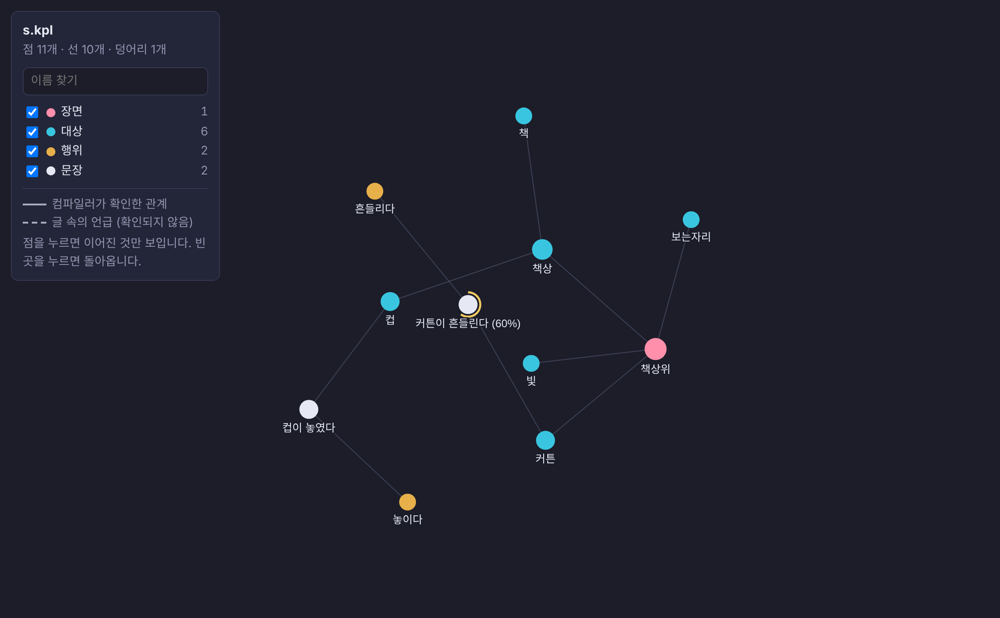
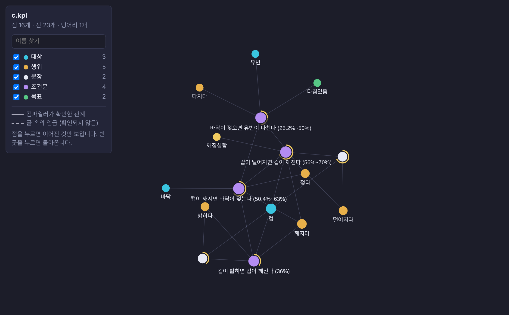
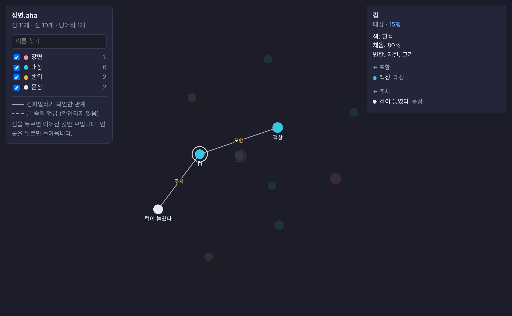

# Chapter 9. The graph

> In this chapter
> - Turning a file into a network of nodes and edges
> - Solid and dotted edges
> - Disconnected components as a finding
> - The viewer

*Corresponds to chapter 18 of the Korean edition.*

## 9.1 From lines to a network

A file is read top to bottom, but what it describes is not a line. Names refer to each other, sentences share objects, a degree travels through several conditionals. `aha 그래프 file.aha` (or `aha graph`) writes `file.그래프.html`, a page that shows this structure.

```aha
낱말 책상: 재질, 가로(거리)
낱말 컵: 색* 3, 재질, 채움(정도) 2

장면 책상위
  책상: 재질 나무, 가로 120 센티미터
    컵: 색 흰색, 채움 80%
  빛: 방향 왼쪽 창문, 세기 80%

행위 떨어지다, 깨지다: 주체
컵이 70% 떨어졌다
컵이 떨어지면 컵이 80% 깨진다
```

```text
연결망 | 점 8개, 선 9개, 덩어리 1개
```

That is the output of `aha 그래프`: "Graph | 8 nodes, 9 edges, 1 component." (The gloss for this file is in chapter 10.)



## 9.2 Nodes and edges

| Node | Comes from |
| --- | --- |
| Scene | a `장면` |
| Object | a `대상`, or a word used in a scene (with its filled values and blanks) |
| Action | a `행위` |
| Sentence, conditional | a sentence or a conditional sentence |
| Definition, check, unknown, goal, rule | the statement of that kind |
| Frame, unit, event | a `기준`, a `단위`, a `사건` |
| Reference, prose | a `참조`, a note, an attached line or a `본문` line |

| Edge | Korean label | Meaning | Drawn |
| --- | --- | --- | --- |
| Containment | 포함 | a word is inside a scene or another word | solid |
| Role | 역할 | an object, time or place fills a role of a sentence or event | solid |
| Action | 행위 | a sentence uses a declared action | solid |
| Premise | 전제 | a fact or conclusion feeds a conditional | solid |
| Use | 쓰임 | an expression uses a name | solid |
| Frame, unit | 기준, 단위 | a value lies on a frame or is in a unit | solid |
| Reference, attached | 참조, 딸림 | a sentence cites a reference; prose belongs to a sentence | solid |
| Mention | 언급 | a declared name appears in free prose | **dotted** |

The difference between solid and dotted is the difference between the two layers of chapter 8. A solid edge is a relation the compiler verified from the grammar. A dotted edge only says that a name occurs in a piece of prose; what the prose says about it is not verified.

## 9.3 Degree on the graph

A sentence with a degree is drawn with an arc around its node, and conditionals are connected along the path the degree travels.



## 9.4 Components

Two nodes are in the same **component** if some path of edges joins them. The command reports the number of components, and the viewer lists them.

More than one component is not an error, but it is a finding worth looking at. A typical case: a file defines fees and limits, and its sentences describe who approves what, yet nothing connects the numbers to the sentences. The numbers form islands. Either they are unused, or the connection exists only in the writer's head.

This is computed, not estimated: connectivity is a property of the graph.

## 9.5 The viewer



- Drag nodes; the layout is a force simulation, so connected things pull together.
- Click a node: only that node and its neighbours stay, and the panel on the right lists its relations.
- The page is a single self-contained HTML file. It needs no server and no network connection.

In VS Code the same view opens with the command "AHAA: 연결망 보기".

## 9.6 What the graph is not

The graph shows the relations that were **written**. It is a flat picture of connections, not a picture of the scene: it does not know where the cup is or what it looks like. Turning a description into a spatial layout is step 3 of the plan (chapter 11).

## Summary

- Everything declared becomes a node; relations become edges.
- Solid edges are verified by the grammar, dotted edges are mentions in prose.
- Disconnected components show values or statements that nothing else uses.
