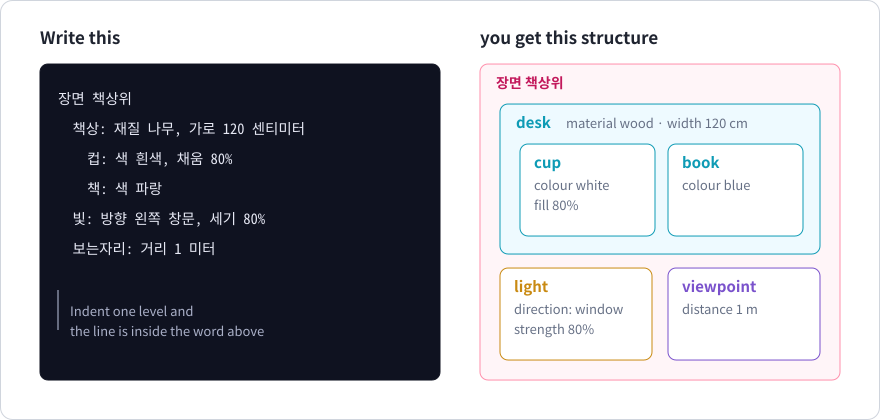
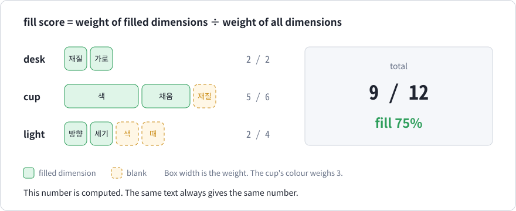

# Chapter 10. Words and scenes

> In this chapter
> - Defining a word as a bundle of dimensions
> - Writing what you see as a scene, with indentation for containment
> - Blanks, weights and the fill score
> - Combining scenes with sentences

*Corresponds to chapter 19 of the Korean edition. This is the central chapter.*

## 10.1 Defining words

```aha
낱말 책상: 재질, 가로(거리)
낱말 컵: 색* 3, 재질, 채움(정도) 2
낱말 책: 색

장면 책상위
  책상: 재질 나무, 가로 120 센티미터
    컵: 색 흰색, 채움 80%
    책: 색 파랑
  빛: 방향 왼쪽 창문, 세기 80%
  보는자리: 거리 1 미터
```

| Korean | English |
| --- | --- |
| `낱말 책상: 재질, 가로(거리)` | word `desk`: material, width (a distance) |
| `낱말 컵: 색* 3, 재질, 채움(정도) 2` | word `cup`: colour (required, weight 3), material, fill (a degree, weight 2) |
| `낱말 책: 색` | word `book`: colour |
| `장면 책상위` | scene `on-the-desk` |
| `책상: 재질 나무, 가로 120 센티미터` | desk: material wood, width 120 cm |
| `컵: 색 흰색, 채움 80%` | cup: colour white, fill 80% |
| `책: 색 파랑` | book: colour blue |
| `빛: 방향 왼쪽 창문, 세기 80%` | light: direction left window, strength 80% |
| `보는자리: 거리 1 미터` | viewpoint: distance 1 m |

```text
검사 통과 | 정의 0개, 검사 0개, 대상 5개, 낱말 3개, 장면 1개
장면 '책상위': 낱말 5개, 채움 64% (빈칸 6개: 컵.재질, 빛.색, 빛.때, 보는자리.높이, 보는자리.방향, 보는자리.화각)
```

Scene `on-the-desk`: 5 words, fill 64%, 6 blanks: `cup.material`, `light.colour`, `light.time`, `viewpoint.height`, `viewpoint.direction`, `viewpoint.angle-of-view`.

`낱말 name: dimension, dimension, …` creates a word. Each dimension can carry three marks, in this order:

| Mark | Meaning | Example |
| --- | --- | --- |
| `*` | required | `색*` |
| `(type)` | type of the value; free text if omitted | `채움(정도)`, `가로(거리)` |
| number | weight, 1 to 100; 1 if omitted | `색* 3` |

- The value of a typed dimension is read as an expression and type-checked. `가로 120 센티미터` is a distance and is stored as 1200 mm.
- The value of an untyped dimension is the text up to the next comma. The value of `방향 왼쪽 창문` is "왼쪽 창문" (left window).
- The word does not need to exist in any dictionary. You can invent one. Its dimensions are its whole meaning as far as AHAA is concerned.

### Built-in words

Four words that almost every scene needs are predefined.

| Word | English | Dimensions |
| --- | --- | --- |
| `보는자리` | viewpoint | `거리` distance (a distance), `높이` height, `방향` direction, `화각` angle of view |
| `빛` | light | `방향` direction, `세기` strength (a degree), `색` colour, `때` time of day |
| `배경` | background | `내용` content |
| `날씨` | weather | `상태` state, `세기` strength (a degree) |

## 10.2 Scenes: indentation is containment



After `장면 name`, the indented lines are the content of the scene.

- **A line indented further than the line above is inside that word.** The cup and the book are on the desk; the light and the viewpoint are at the same level as the desk.
- The amount of indentation is free; only "further than the line above" matters.
- The scene ends at the first line that is not indented.
- To use the same word twice, give the second one a name:

```aha
낱말 책: 색
장면 방
  책: 색 파랑
  책 둘째책: 색 빨강
```

(`책 둘째책: 색 빨강`: a book named `second-book`: colour red.) Without a name the two would be indistinguishable, which is an error:

```aha 오류=K301
낱말 책: 색
장면 방
  책: 색 파랑
  책: 색 빨강
```

Indentation was chosen because containment has many levels and the levels must be visible. The shape of the text is the structure, as in Python and YAML.

## 10.3 Blanks

A dimension with no value is a **blank**. Blanks are reported, not rejected.

A dimension that must never be left out gets a star. An empty starred dimension is an error:

```aha 오류=K704
낱말 컵: 색* 3, 재질
장면 방
  컵: 재질 유리
```

```text
예제.aha(3,3): error K704: '컵'의 '색'은 꼭 적어야 하는 차원입니다. 예: '컵: 색 값'
```

"`colour` of `cup` is a required dimension."

## 10.4 Weights and the fill score



Dimensions do not matter equally. For drawing a cup, its colour changes the picture more than its material. The number after a dimension is its **weight**.

```text
fill = (sum of weights of filled dimensions) ÷ (sum of weights of all dimensions) × 100, rounded down
```

For the scene in 10.1:

| Word | Dimensions (weight) | Filled | Filled weight / total |
| --- | --- | --- | --- |
| desk | material 1, width 1 | both | 2 / 2 |
| cup | colour 3, material 1, fill 2 | colour, fill | 5 / 6 |
| book | colour 1 | colour | 1 / 1 |
| light | direction 1, strength 1, colour 1, time 1 | direction, strength | 2 / 4 |
| viewpoint | distance 1, height 1, direction 1, angle 1 | distance | 1 / 4 |
| total | | | 11 / 17 = 64% |

**What this number says.** It is arithmetic: the same text always gives the same number. But it measures how much of what you **declared** you filled in, not how well the scene is described. Declare two dimensions, fill both, and the score is 100%. Objects you did not put in the scene do not count either. And the weights are, for now, chosen by the writer. Measuring how much each dimension really changes a picture belongs to the later steps (chapter 11).

## 10.5 Errors

| Code | Meaning | Example |
| --- | --- | --- |
| `K701` | the same dimension twice in a word | `낱말 컵: 색, 색` |
| `K702` | a word used in a scene without a definition | `의자: 색 검정` (chair) |
| `K703` | a dimension the word does not have, or filled twice | `책: 무게 3` (weight) |
| `K704` | a required dimension left empty | no colour for `색*` |

A typed dimension rejects a value of another type with the ordinary type error of chapter 3:

```aha 오류=K303
낱말 컵: 색, 채움(정도)
장면 방
  컵: 색 흰색, 채움 3 미터
```

"`fill` needs a degree, but the expression is a distance."

## 10.6 Scenes and sentences together

A word used in a scene becomes an object, so the sentences of chapters 6 and 7 can talk about it. The scene says what is where and how it looks; the sentences say what happens.

```aha
주제 <창가의 책상>

낱말 책상: 재질, 가로(거리)
낱말 컵: 색* 3, 재질, 채움(정도) 2

장면 방
  책상: 재질 나무
    컵: 색 흰색

행위 떨어지다, 깨지다: 주체
컵이 70% 떨어졌다
컵이 떨어지면 컵이 80% 깨진다 곱으로
```

| Korean | English |
| --- | --- |
| `주제 <창가의 책상>` | topic: a desk by the window |
| `행위 떨어지다, 깨지다: 주체` | actions `fall`, `break`: agent |
| `컵이 70% 떨어졌다` | the cup fell, 70% |
| `컵이 떨어지면 컵이 80% 깨진다 곱으로` | if the cup falls, the cup breaks, 80%, by product |

```text
장면 '방': 낱말 2개, 채움 50% (빈칸 3개: 책상.가로, 컵.재질, 컵.채움)
조건문 12행: 56% (곱으로 계산)
```

`주제 <…>` (*topic*) states at the top of a file what the file describes, once per file, in the spirit of an `#include` line. It is stored in the compiled output.

## 10.7 Background

**Frames and slots.** Seeing a word as a set of slots to fill goes back to the 1970s. Minsky proposed that understanding a situation means retrieving a **frame** and filling its slots, with defaults for what was not observed. Fillmore applied the idea to word meaning as **frame semantics**: the word "buy" brings a buyer, a seller, goods and a price with it. The `행위` declaration of chapter 6 was already a frame for a verb; `낱말` extends the idea to things and states.

There is one deliberate difference from human frames. People fill an empty slot with a default and move on. AHAA does not fill it; it **reports it as empty**. Filling is left to the later AI check, which must keep "written by the person" and "filled in" apart.

**Tree and net.** An indented scene is a tree: every word has exactly one parent, like an HTML document. A tree cannot say that the cup is to the left of the book. That is why AHAA adds sentences on top of the tree, and the result is the graph of chapter 9.

**Compression and definition.** A short text can carry a lot only if the reader already has the missing information. The word definition is that information. `컵: 색 흰색` works because the definition says what dimensions a cup has. The information has not disappeared; it has moved into the definition. People are reluctant to memorise long definitions, but a machine reads the definition every time, which makes "long definitions, short text" practical when the reader is a machine.

## 10.8 Known limits

- Positions between words (left, in front, above) cannot be written yet; only containment.
- An untyped value is text and is not checked. The compiler does not know that `흰색` and `하양` are both "white".
- Lines inside a scene cannot carry notes or attached lines.
- Weights are chosen by the writer, not measured.
- A word cannot be defined by inheriting from another word.
- Do not mix tabs and spaces in indentation.

## Summary

- `낱말` defines dimensions with optional star, type and weight; `장면` fills them, with indentation for containment.
- Unfilled dimensions are blanks; unfilled starred dimensions are errors.
- The fill score is the weighted share of declared dimensions that have a value, and nothing more than that.
