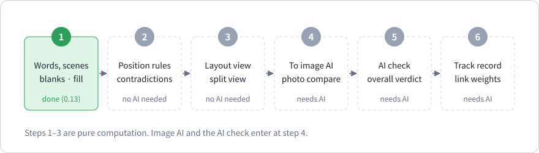

# Chapter 11. What is measured, and what comes next

> In this chapter
> - The quantities AHAA computes today, each with a definition
> - The quantities that are planned, with definitions fixed in advance
> - The two claims the project rests on, and how they could be tested
> - The six steps and the known limits

*Corresponds to chapter 20 of the Korean edition and to the design draft (`DESIGN.md`). Sections 11.2 to 11.5 describe plans. None of it is implemented, and the examples there are not compiled.*

## 11.1 Measured today

An idea such as "a language that describes reality" is too large to measure. What can be measured are specific quantities with an **operational definition**: a procedure that turns a text into a number. These are the ones the compiler produces now. All are deterministic.

| Quantity | Operational definition | Chapter |
| --- | --- | --- |
| Blank count | Number of declared dimensions in a scene without a value | 10 |
| Fill score | Σ weight(filled) ÷ Σ weight(all declared dimensions) × 100, rounded down | 10 |
| Components | Number of connected components of the graph | 9 |
| Prose warnings | Occurrences of five fixed patterns in prose (`K601` to `K605`) | 8 |
| Range of an unknown | Tightest lower and upper bound implied by the constraints | 5 |
| Verdict of a goal | Guaranteed, possible or impossible over all solutions | 5 |
| Degree range | Result of a rule chain under minimum and under product | 7 |

Each of these answers a narrow question exactly. None of them answers "is this a good description".

## 11.2 Planned measurements

| Quantity | Definition | Needs |
| --- | --- | --- |
| **Agreement**, per dimension | An AI model reads the same text N times and is asked to fill every blank. For each dimension, agreement is the share of readings that give the same value. Reported as a range (for example 68% to 76%), because it varies between runs | An AI model |
| **Reconstruction similarity** | A real scene is photographed and described in AHAA. An image model draws several pictures from the text alone. The pictures are compared with each other and with the photograph | An image model; a comparison method, not yet chosen |
| **Track record**, per word | Over past checks of texts using the word: passes ÷ trials, always shown together with the number of trials | Stored check logs |
| **Connectivity score** | Share of the words in a scene that are connected to something else | Nothing; planned for step 2 |

Dimensions on which the readings scatter are the under-specified ones. That is the use of the agreement score: not a grade, but a pointer to where the text leaves room.

## 11.3 The overall verdict

The scores are not averaged.

```text
gate fails                                  → not usable   (shows what to fix)
gate passes, fill < 80 or agreement < 70    → needs work   (shows empty or scattered dimensions)
gate passes, fill ≥ 80 and agreement ≥ 70   → usable
```

- The **gate** is the computed check: grammar, undeclared words, unit mismatches, missing required dimensions and, later, contradictory positions. One failure blocks the text whatever the scores are.
- 80 and 70 are **provisional**. They are to be set from observation: above which scores did the reconstruction actually resemble the original?
- Without an AI run the verdict reads "computed check only". A text is never called usable on a score that was not measured.

## 11.4 The two claims

The project rests on two empirical claims. Neither has been tested.

**Claim 1.** Writers omit dimensions without noticing, and showing the blanks makes their descriptions more complete.

- *Test.* The same people describe the same scenes twice, once in plain prose and once in AHAA with the blank list. Count the dimensions that end up specified.
- *If it fails.* The blank list is noise, and the structure costs more effort than it returns.

**Claim 2.** A more complete description yields a reconstruction closer to the original scene.

- *Test.* For one scene, write descriptions with different fill scores and compare reconstruction similarity.
- *If it fails.* The fill score does not predict anything useful, and weights must be derived from measured effect on the picture instead of being chosen by the writer.

**What is not claimed.** That AI models read this notation better than natural language. Current language models are trained mostly on natural language and code, and an unfamiliar notation is, if anything, a disadvantage on that side. The claim concerns the writer. For the model, a converter turns a scene into an ordinary prompt (step 4), so the model never needs to learn AHAA.

## 11.5 The six steps



| Step | Content | Needs AI | Status |
| --- | --- | --- | --- |
| 1 | Topic, words, scenes, weights, blanks, fill score | No | Done (0.13) |
| 2 | Rules for writing positions ("the cup is left of the book"), contradiction checks, connectivity score | No | Planned |
| 3 | A layout computed from the text, shown beside the editor | No | Planned |
| 4 | Conversion to an image-model prompt; a first experiment with one real photograph | Image model | Planned |
| 5 | The AI check (agreement, remarks) and the overall verdict | Yes | Planned |
| 6 | Word track records and weights on graph edges | Logs from step 5 | Planned |

A position rule might look like this. It is a sketch, not valid AHAA today:

```text
컵이 책의 왼쪽에 있다        the cup is to the left of the book
책이 컵의 왼쪽에 있다        the book is to the left of the cup   → contradiction
```

Steps 1 to 3 run without any AI. Step 4 is where the success criterion of chapter 1 is measured for the first time, and its result decides whether the grammar of step 2 and the thresholds of 11.3 need to change.

## 11.6 Known limits

- The ceiling is set by the image model. If it miscounts objects or misplaces them, an exact text does not help.
- "Degree 70%" is a number the writer assigned, not the sensation itself.
- AI scores depend on the model and its version. A recorded score must say which model produced it.
- A track record says how texts using a word fared, not that the word is good. It is affected by the other words in those texts and must not be read as a cause.
- The meaning of an invented word is whatever its definition says. At the bottom, a definition must rest on measurable quantities or on ordinary words the model already knows, and with those ordinary words ambiguity comes back in.
- A text cannot hold as much information as a photograph. The aim is a recognisably similar scene, not a copy.

## Summary

- What is computed today has exact definitions and narrow meanings.
- Agreement, reconstruction similarity and track record are defined but not built.
- Two testable claims carry the project; the plan is ordered so that they are tested early.
