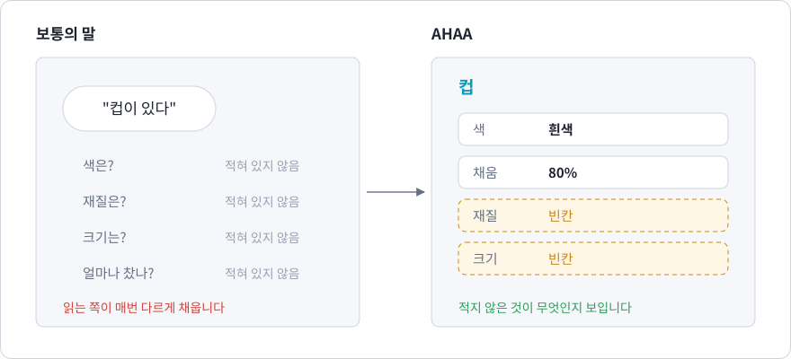
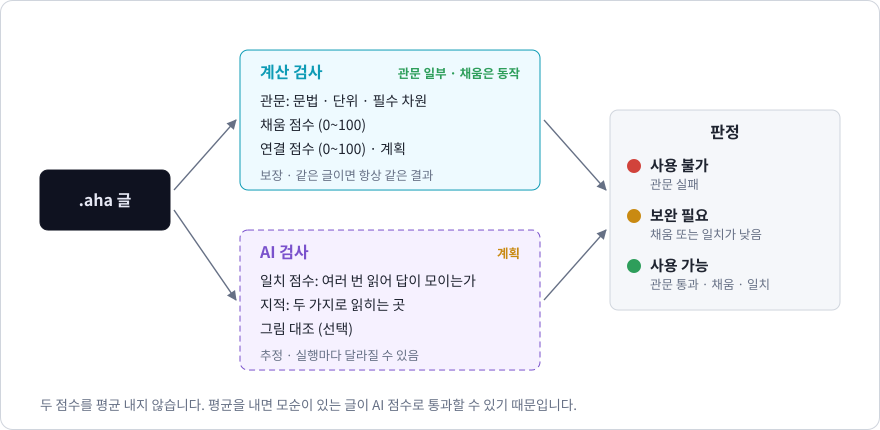
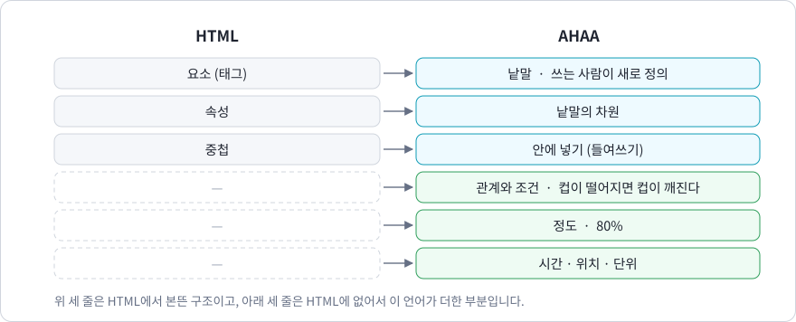
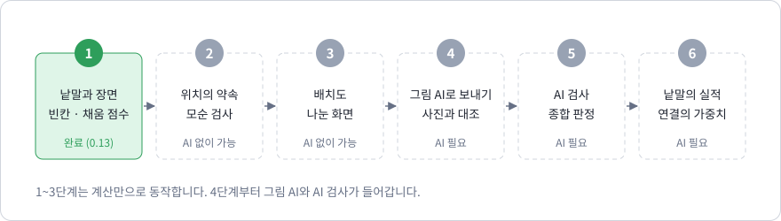

# 1장. AHAA란 무엇인가

> 이 장에서 배우는 것
> - AHAA가 풀려는 문제: 낱말은 대부분을 생략한다
> - AHAA가 하는 세 가지 일: 적는다, 잇는다, 검사받는다
> - 선언형 언어라는 말의 뜻과, HTML에서 본뜬 것
> - 정해진 구조, 열린 내용, 보이는 빈칸
> - 지금 되는 것과 앞으로 할 것

**AHAA — AI-bound Human language, Assessed by AI.** AI에게 전할 말을, 사람이, 검사를 받아 다듬는 언어입니다. "아하"라고 읽습니다.

## 1.1 낱말은 대부분을 생략한다

"컵이 있다"라는 말에서 컵은 무슨 색입니까. 무엇으로 만들었고, 얼마나 차 있습니까. 말에는 없습니다. 보통의 말은 낱말 하나에 대부분을 생략하고, 듣는 사람이 맥락으로 채우게 합니다. 그래서 말은 짧습니다.

사람끼리는 이것으로 충분합니다. 그런데 읽는 쪽이 AI일 때는 문제가 됩니다. 그림을 그리는 AI에게 "컵이 있다"고 하면 색과 크기를 매번 다르게 지어냅니다. 일을 시키는 AI에게 "보고서를 정리해"라고 하면 누가 읽을 보고서인지, 언제까지인지를 스스로 정합니다. 더 큰 문제는 **쓰는 사람도 무엇을 빠뜨렸는지 모르고 지나간다**는 것입니다.



AHAA에서 낱말은 이름표 하나가 아니라 **차원의 묶음**입니다. 낱말을 쓴다는 것은 그 차원에 값을 채우는 일이고, 채우지 않은 차원은 사라지지 않고 **빈칸**으로 보고됩니다.

```aha
낱말 컵: 색* 3, 재질, 채움(정도) 2

장면 식탁
  컵: 색 흰색, 채움 80%
```

```text
장면 '식탁': 낱말 1개, 채움 83% (빈칸 1개: 컵.재질)
```

컵에는 색, 재질, 채움이라는 차원이 있고, 그 가운데 재질을 적지 않았다고 컴파일러가 알려 줍니다. 수 3과 2는 차원의 무게이고, 83%는 그 무게로 잰 "얼마나 채웠는가"입니다. 19장에서 자세히 다룹니다.

## 1.2 AHAA가 하는 세 가지 일

| 하는 일 | 무엇으로 | 다루는 장 |
| --- | --- | --- |
| **적는다** | 낱말과 차원, 장면, 값과 단위 | 3, 4, 16, 19장 |
| **잇는다** | 문장, 시간과 공간, 정도, 조건 | 5, 6, 8~11, 13, 14장 |
| **검사받는다** | 계산 검사(지금)와 AI 검사(앞으로) | 7, 17, 18, 19, 20장 |

**적는다.** 무엇이 있는지를 낱말과 차원으로 적습니다. 원래 있는 낱말이 아니어도 됩니다. 쓰는 사람이 낱말을 정의하고, 정의에 적은 차원이 그 낱말의 전부입니다.

**잇는다.** 낱말만 늘어놓아서는 현실이 되지 않습니다. 누가 무엇을 했는지, 언제 어디서인지, 얼마나 그러한지, 무엇이 무엇을 일으키는지를 적어야 합니다. AHAA는 이것을 한국어 문장으로 적습니다. `컵이 70% 떨어졌다`, `컵이 떨어지면 컵이 80% 깨진다`.

**검사받는다.** 적은 글은 AI에게 가기 전에 검사를 받습니다. 검사는 두 가지입니다.



- **계산 검사**는 문법, 단위, 빠진 역할, 빈칸, 모순을 계산으로 확인합니다. 같은 글이면 언제나 같은 결과가 나옵니다. 지금 동작합니다.
- **AI 검사**는 글을 여러 번 읽어 해석이 한 가지로 모이는지를 잽니다. 추정이며 실행마다 달라질 수 있습니다. 아직 만들지 않았습니다(20장).

이 책의 대부분은 계산 검사에 대한 것입니다. 계산 검사가 "통과했으면 믿을 수 있다"는 바탕을 만들고, AI 검사는 그 위에 얹습니다.

## 1.3 관계를 쓴다

AHAA는 계산 절차를 적는 언어가 아닙니다.

대부분의 프로그래밍 언어는 **무엇을 어떤 순서로 계산할지**를 적습니다. 변수에 값을 넣고, 조건에 따라 분기하고, 반복하면서 답을 만들어 갑니다. 이런 언어를 **명령형(imperative) 언어**라고 합니다. C, Java, Python이 대표적입니다.

AHAA는 다른 질문에서 출발합니다. **무엇과 무엇이 어떤 관계에 있어야 하는가?** 사용자는 관계만 적고, 그 관계가 서로 맞는지, 무엇이 확정되고 무엇이 아직 열려 있는지는 컴파일러가 판정합니다.

간단한 예를 보겠습니다. 실험에서 화면이 1초에 켜지고, 사람이 그것을 보고 버튼을 누르는데, 반응은 최대 200밀리초 안에 일어난다고 합시다. 버튼이 1.1초 안에 눌린다고 장담할 수 있을까요?

```aha
기준 실험시계: 시간축
사건 자극: 시작 = 실험시계 @ 1000 밀리초

미지 반응: 시각 = 실험시계 @ ?
조건 반응은자극뒤 = 반응 >= 자극.시작
조건 지연상한 = 반응 - 자극.시작 <= 200 밀리초

목표 마감준수 = 반응 <= 실험시계 @ 1100 밀리초
```

이 파일에는 계산 절차가 한 줄도 없습니다. 그런데 컴파일러는 다음과 같이 답합니다.

```text
미지 '반응': 1000 밀리초 ~ 1200 밀리초 (실험시계 기준)
목표 '마감준수': 가능 (보장 여부를 확정하려면 관측 필요: 반응)
```

반응 시각은 1000~1200밀리초 사이 어딘가이고, 1100밀리초 마감은 지킬 수도 있지만 **보장되지는 않는다**는 판정입니다. 그리고 확정하려면 무엇을 관측해야 하는지(반응 시각)까지 알려 줍니다. 이 범위와 판정은 어림짐작이 아니라 7장에서 설명할 수학적 방법으로 정확히 계산된 것입니다.

## 1.4 선언형 언어

계산 절차 대신 성립해야 할 관계나 원하는 결과를 적는 언어를 **선언형(declarative) 언어**라고 합니다. 이미 익숙한 예가 있습니다.

| 언어 | 무엇을 선언하는가 |
| --- | --- |
| SQL | 원하는 데이터의 조건 ("나이가 20 이상인 학생") |
| HTML | 문서의 구조 ("이것은 제목, 이것은 문단") |
| Prolog | 사실과 규칙 ("부모의 부모는 조부모다") |
| 스프레드시트 수식 | 칸 사이의 관계 (`=A1+B1`) |

SQL로 데이터를 찾을 때 우리는 데이터베이스가 어떤 순서로 디스크를 읽을지 적지 않습니다. 원하는 조건만 적으면 데이터베이스가 방법을 찾습니다. AHAA도 같습니다. "반응은 자극 뒤에 오고, 지연은 200밀리초 이하"라고 적으면, 반응 시각의 범위를 구하는 방법은 컴파일러가 압니다.

AHAA의 겉모습은 이 가운데 **HTML**에서 본떴습니다. HTML은 요소와 속성, 그리고 안에 넣기(중첩)로 문서를 적습니다. AHAA는 낱말과 차원, 들여쓰기로 장면을 적습니다. HTML에 없는 것, 곧 옆에 있는 것끼리의 관계와 정도와 시간이 AHAA가 더한 부분입니다.



## 1.5 정해진 구조, 열린 내용, 보이는 빈칸

AHAA의 목표는 "규칙은 정해져 있되, 내용은 열려 있는 언어"입니다. 이것을 층으로 나누어 실현합니다.

| 층 | 성격 | 예 |
| --- | --- | --- |
| **구조** (정적) | 컴파일할 때 엄격하게 검사합니다. 어기면 컴파일되지 않습니다. | 주어가 없는 문장, 가리키는 내용이 없는 "이렇게", 시각과 지속 시간의 혼동 |
| **내용** (가변) | 값이 열려 있어도 컴파일됩니다. 컴파일러는 그 열린 상태를 정확히 계산해 보여 줍니다. | 아직 모르는 값의 범위, 목표의 보장·가능·불가능, 문장이 참인 정도 70% |

구조 층의 예를 하나 보겠습니다. AHAA에서는 한국어 문장을 그대로 쓸 수 있지만, 누가 했는지가 빠지면 컴파일되지 않습니다.

```aha 오류=K504
대상 유빈
대상 설계안
행위 설계하다: 주체, 대상

이렇게 설계를 하다
```

```text
예제.aha(5,9): error K504: 행위 '설계하다'에는 '주체' 역할이 필요합니다. 누가 했는지(주체)가 없습니다. '유빈이'처럼 이/가 조사로 밝히세요.
```

일상 한국어에서는 주어를 자주 생략하지만, 명세에서 "누가"가 빠지면 책임과 관계가 모호해집니다. 그래서 AHAA는 이 생략을 규칙으로 금지합니다. 주어를 밝히고, "이렇게"가 무엇을 가리키는지 참조로 적으면 컴파일됩니다.

```aha
대상 유빈
대상 설계안
행위 설계하다: 주체, 대상

유빈이 설계안을 이렇게 설계했다 (참조 1)

참조 1: 모듈을 세 층으로 나누고, 각 층은 바로 아래 층만 참조한다
```

내용 층의 예도 보겠습니다. 컵이 "70% 떨어졌다"고 쓰면, 떨어진 정도 70%와 떨어지지 않은 정도 30%가 **동시에** 일부씩 참인 상태가 됩니다.

```aha
대상 컵
행위 떨어지다: 주체

떨어짐: 컵이 70% 떨어졌다
정의 공존: 정도 = 떨어짐 그리고 아님 떨어짐
검사 떨어지되떨어지지않음 = 공존 == 30%
```

고전 논리에서는 "A 그리고 A가 아님"이 언제나 거짓입니다. 그러나 AHAA가 쓰는 퍼지 논리에서는 이 값이 30%입니다. 10장에서 이 원리를 자세히 다룹니다.

여기에 0.13에서 셋째 층이 더해졌습니다.

| 층 | 성격 | 예 |
| --- | --- | --- |
| **빈칸** (보고) | 적지 않은 것을 오류로 막지도, 모른 척 넘기지도 않고 목록으로 보여 줍니다. | 컵의 재질, 빛의 색 |

세 층은 "적지 않은 것"을 다루는 세 가지 방법입니다. 꼭 있어야 하는 것이 빠지면 **거절**하고(구조), 값을 모르는 것은 **범위로 계산**하고(내용), 적어도 되고 안 적어도 되는 것은 **빈칸으로 알립니다**.

## 1.6 계산기 같은 언어가 아닌 이유

AHAA도 덧셈과 비교를 합니다. 그러나 계산은 목적이 아니라 관계를 확인하는 수단입니다. 차이는 세 가지입니다.

1. **답이 하나가 아닐 수 있습니다.** 미지값이 있으면 컴파일러는 값 하나가 아니라 가능한 범위와, 목표가 그 범위 전체에서 성립하는지를 돌려줍니다.
2. **의미가 다른 값은 섞을 수 없습니다.** "3시 + 5시"는 계산기에서는 8이지만, AHAA에서는 오류입니다. 시각끼리는 더할 수 없기 때문입니다(5장).
3. **글처럼 쓸 수 있습니다.** 문장의 조사가 각 낱말의 역할을 정하고, 동사의 시제가 시간 관계를 만듭니다(8장, 11장).

## 1.7 세 가지 수

AHAA는 수가 붙어 다니는 언어입니다. 뜻이 다른 세 가지 수를 섞지 않습니다.


| 수 | 뜻 | 누가 정하는가 | 상태 |
| --- | --- | --- | --- |
| **정도** | 얼마나 그러한가 (`컵이 80% 차 있다`) | 쓰는 사람이 적음 | 지금 동작 (10, 13, 14장) |
| **일치** | 이 글을 읽은 결과가 얼마나 한 가지로 모이는가 | AI 검사가 잼 | 앞으로 (20장) |
| **실적** | 이 낱말이 지금까지의 검사에서 얼마나 잘 통했는가 | 도구가 검사 기록에서 쌓음 | 앞으로 (20장) |

여기에 계산으로 나오는 **채움 점수**(19장)와 차원의 **가중치**가 더해집니다. 어느 수든 누가 정했고 무엇을 뜻하는지가 분명해야 합니다.

## 1.8 지금 되는 것과 앞으로 할 것

완성도의 기준은 하나입니다. **보이는 장면을 이 언어로 적고, 그 글만으로 그림 AI가 그린 그림이 원래 장면과 얼마나 비슷한가.**



| | 지금 (0.14) | 앞으로 |
| --- | --- | --- |
| 적는다 | 낱말, 차원, 장면, 값과 단위 | 낱말끼리의 위치 |
| 잇는다 | 문장, 시간과 공간, 정도, 조건문 | 문형 넓히기 |
| 검사받는다 | 문법·단위·역할·모순, 빈칸과 채움 점수, 본문 점검, 연결망 | AI 검사, 일치, 실적, 그림 대조 |
| 보여 준다 | 편집기의 실시간 검사, 연결망 | 글 옆에 그려지는 배치도 |

이 책은 지금 되는 것을 설명합니다. 앞으로 할 것은 20장에 따로 모았고, 다른 장에서는 "앞으로"라고 밝힌 곳에만 나옵니다.

AHAA가 약속하지 않는 것도 있습니다. 글에는 사진만큼의 정보가 들어가지 않으므로 완벽한 재현은 목표가 아닙니다. 사람끼리의 일상 대화를 대신하려는 언어도 아닙니다.

## 1.9 학문적 배경의 지도

AHAA의 각 기능은 이미 연구된 이론 위에 서 있습니다. 근거가 분명한 범위까지만 구현하고, 그 밖의 경우는 명확한 진단으로 거절합니다.

| 기능 | 이론 | 다루는 장 |
| --- | --- | --- |
| 시각과 지속 시간의 구분 | 아핀 공간 (수학) | 5장 |
| 사건과 역할 | 신-데이비드슨 사건 의미론 (언어철학) | 6장 |
| 미지값의 범위와 판정 | Simple Temporal Network (인공지능) | 7장 |
| 조사로 역할 정하기, 필수 성분 | 격조사, 논항 구조 (언어학) | 8장 |
| 자연어처럼 보이는 엄격한 문법 | 통제 자연어 (전산언어학) | 8장 |
| "이렇게"와 참조 | 담화 표상 이론 (형식 의미론) | 9장 |
| 70%의 정도 | 퍼지 논리 (논리학) | 10장 |
| 시제 | Reichenbach의 시제 모형 (언어철학) | 11장 |
| 규칙으로 정도 전하기 | 퍼지 추론: Mamdani와 Larsen의 방식 (제어 이론) | 13장 |
| 문장으로 쓰는 규칙, 사실 찾기 | 전방 추론, 존재 양화, 닫힌 세계 가정 (논리 프로그래밍) | 14장 |
| 편집기 연결 | 언어 서버 프로토콜 (소프트웨어 공학) | 15장 |
| 단위를 타입으로 | 차원 분석 (물리학, 타입 이론) | 16장 |
| 자유로운 글의 점검 | 중의성, 린트 (언어학, 소프트웨어 공학) | 17장 |
| 글을 점과 선으로 | 그래프, 의미망 (수학, 인공지능) | 18장 |
| 차원의 묶음인 낱말 | 틀과 빈자리, 틀 의미론 (인공지능, 언어학) | 19장 |

이 지도를 처음부터 이해할 필요는 없습니다. 각 장에서 필요한 만큼 차근차근 설명합니다.

## 1.10 이름에 대하여

- **AHAA**의 네 글자는 **A**I-bound(AI에게 가는) **H**uman language(사람의 말), **A**ssessed by **A**I(AI가 검사하는)입니다. "아하"라고 읽습니다.
- 명령 실행 파일의 이름은 `aha`, 소스 파일의 확장자는 `.aha`입니다.
- 0.13까지의 이름은 RelSpec(*Relation Specification*, 관계 명세)이었고, 명령은 `kpl`, 확장자는 `.kpl`이었습니다. 관계를 적는다는 그때의 중심은 지금도 "잇는다"로 남아 있습니다.
- 현재는 한국어 문법만 있습니다.

## 정리

- AHAA는 사람이 AI에게 전할 말을 빠뜨린 것 없이 적도록 돕는 언어입니다.
- 낱말은 **차원의 묶음**이고, 적지 않은 차원은 **빈칸**으로 보입니다.
- 하는 일은 셋입니다: **적는다, 잇는다, 검사받는다.**
- 계산 절차가 아니라 관계를 적는 **선언형** 언어이며, 겉모습은 HTML에서 본떴습니다.
- 꼭 있어야 하는 것은 거절하고, 모르는 값은 범위로 계산하고, 그 밖의 것은 빈칸으로 알립니다.
- 계산 검사는 지금 동작하고, AI 검사는 앞으로 할 일입니다.

## 연습 문제

1. 명령형 언어와 선언형 언어의 차이를, 일상에서 길을 알려 주는 두 가지 방식("두 블록 가서 왼쪽" 대 "역 앞 은행 옆")에 빗대어 설명해 보세요.
2. 1.3의 예에서 반응 지연의 상한을 200밀리초에서 100밀리초로 줄이면 `마감준수` 목표의 판정은 어떻게 바뀔지 예상해 보세요.

<details>
<summary>풀이</summary>

1. "두 블록 가서 왼쪽"은 절차를 알려 주는 명령형 방식이고, "역 앞 은행 옆"은 도착지가 만족할 관계를 알려 주는 선언형 방식입니다. 선언형 설명을 들은 사람은 길을 스스로 찾습니다.
2. 반응 시각의 범위가 1000~1100밀리초가 되므로, 모든 경우에 1100밀리초 이하입니다. 판정은 **보장**이 됩니다. 직접 확인해 볼 수 있습니다.

```aha
기준 실험시계: 시간축
사건 자극: 시작 = 실험시계 @ 1000 밀리초
미지 반응: 시각 = 실험시계 @ ?
조건 반응은자극뒤 = 반응 >= 자극.시작
조건 지연상한 = 반응 - 자극.시작 <= 100 밀리초
목표 마감준수 = 반응 <= 실험시계 @ 1100 밀리초
```

</details>
