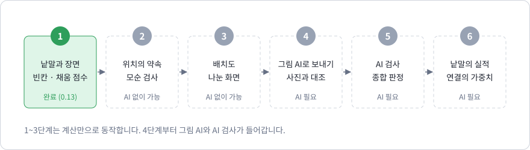
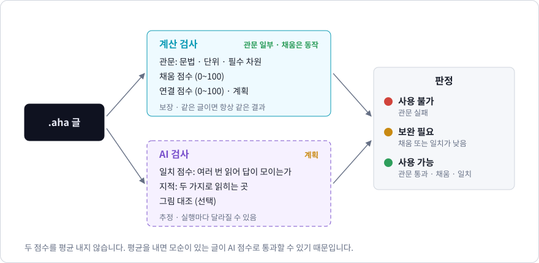
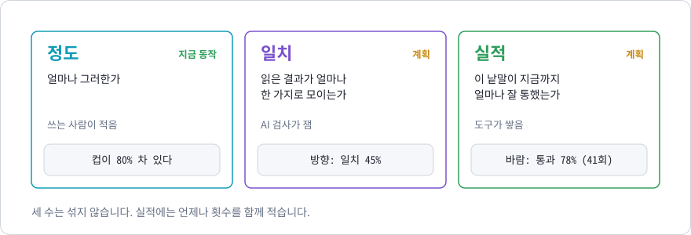

# 20장. 앞으로: AI 검사, 일치, 실적

> 이 장에서 배우는 것
> - 설계안의 남은 다섯 단계가 무엇이고 왜 그 순서인가
> - 위치를 읽는 약속과 배치도
> - AI 검사가 재려는 것: 일치
> - 계산 검사와 AI 검사의 점수를 섞지 않는 이유
> - 낱말의 실적과, 통계를 읽을 때 조심할 것

**AHAA에서 이 장의 자리 (검사받는다: 앞으로).** 이름의 뒤쪽 절반인 "Assessed by AI"가 이 장입니다.

> **이 장의 내용은 아직 구현되지 않았습니다.** 다른 장은 지금 동작하는 것을 설명하고 모든 예제를 컴파일러로 검사합니다. 이 장은 계획이며, 여기 적힌 문법과 수는 만들면서 바뀔 수 있습니다. 예제는 `text`로 적었고 검사하지 않습니다. 구현되면 그 내용은 새 장으로 옮기고 이 장에서 지웁니다. 설계의 원문은 저장소의 `DESIGN.md`입니다.

## 20.1 여섯 단계



| 단계 | 내용 | AI | 상태 |
| --- | --- | --- | --- |
| 1 | 낱말과 장면, 빈칸과 채움 점수 | 아니오 | 완료 (19장) |
| 2 | 낱말끼리의 위치를 읽는 약속과 모순 검사 | 아니오 | 앞으로 |
| 3 | 글 옆에 그려지는 배치도 | 아니오 | 앞으로 |
| 4 | 그림 AI용 지시문, 실제 사진과 대조 | 그림 AI | 앞으로 |
| 5 | AI 검사와 종합 판정 | 예 | 앞으로 |
| 6 | 낱말의 실적과 연결의 가중치 | 5단계의 기록 | 앞으로 |

순서에는 이유가 있습니다. 1~3단계는 계산만으로 되므로 결과를 자동 시험으로 확인할 수 있습니다. 이 바탕이 먼저 있어야 4단계부터 들어오는 AI의 결과를 무엇과 견줄지가 생깁니다. 6단계의 통계는 5단계의 검사가 기록을 남겨야 채워집니다.

완성도의 기준은 4단계에서 처음 잽니다. **보이는 장면을 이 언어로 적고, 그 글만으로 그림 AI가 그린 그림이 원래 장면과 얼마나 비슷한가.**

## 20.2 위치를 읽는 약속 (2단계)

19장의 장면은 "안에 있다"만 적습니다. 컵이 책의 왼쪽에 있다는 것은 적지 못합니다. 2단계는 이것을 문장으로 적게 합니다.

```text
컵이 책의 왼쪽에 있다
책이 컵의 왼쪽에 있다        ← 앞 문장과 모순
```

여기서 정해야 하는 것이 "왼쪽"의 기준입니다. 설계안의 약속은 다음과 같습니다.

- 왼쪽·오른쪽·앞·뒤·위·아래는 **보는자리에서 본 방향**입니다.
- 안에 넣은 것은 따로 적지 않으면 부모의 위에 놓인 것으로 봅니다.
- 거리와 크기는 단위와 함께 적고, 적지 않으면 빈칸입니다.

위치의 모순을 찾는 계산은 이미 있습니다. "컵이 책의 왼쪽"은 "컵의 가로 자리 < 책의 가로 자리"라는 차이 제약이고, 7장의 방법이 두 제약이 함께 성립할 수 없음을 음의 순환으로 찾습니다. 시간에 쓰던 수학을 공간에 다시 쓰는 것입니다.

이 약속은 설계에서 가장 어려운 부분입니다. "앞"이 보는 사람 쪽인지 물건의 앞면 쪽인지처럼, 말로는 자연스럽지만 하나로 정하기 어려운 것이 많습니다. 실제 장면을 적어 보면서 고칩니다.

## 20.3 배치도 (3단계)

HTML은 쓰는 즉시 화면에 나옵니다. 브라우저가 계산으로 그리기 때문입니다. AHAA도 같은 것을 가지려 합니다.

```text
┌───────────────────────────┬───────────────────────────────┐
│ 장면 책상위               │  [배치도]                     │
│   책상: 재질 나무, …      │   컵 □  책 □   ← 빛            │
│     컵: 색 흰색, 채움 80% │                               │
│     책: 색 파랑           │  채움 82 · 연결 100 · 일치 —   │
│   빛: 방향 왼쪽 창문, …   │  빈칸: 컵.크기, 책.크기, 빛.색 │
│ 컵이 책의 왼쪽에 있다     │  [AI 검사]  [그림 그리기]      │
└───────────────────────────┴───────────────────────────────┘
```

배치도는 그림이 아니라 도면입니다. 낱말을 도형으로, 위치와 크기와 빛의 방향을 적힌 대로 놓습니다. 위치를 적지 않은 낱말은 "자리 미정"으로 따로 모읍니다. 계산으로 그리므로 글자를 칠 때마다 바뀝니다.

배치도와 AI가 그린 그림은 맡는 일이 다릅니다.

| | 배치도 | AI의 그림 |
| --- | --- | --- |
| 무엇을 보여 주나 | 언어가 이 글을 어떻게 읽었는가 | 그 읽기로 현실이 얼마나 재현되는가 |
| 만드는 방법 | 계산 | 그림 AI |
| 언제 | 글자를 칠 때마다 | 버튼을 누를 때 |
| 같은 글이면 | 항상 같은 도면 | 매번 다른 그림 |

## 20.4 그림 대조 (4단계)

장면을 그림 AI가 알아듣는 지시문으로 바꾸는 변환기를 둡니다. 언어는 그대로 두고 그림 AI마다 변환기만 바꿉니다. 컴파일러가 대상 기계마다 다른 코드를 내는 것과 같은 구조입니다.

대조는 두 방향으로 봅니다.

1. **그림끼리의 차이.** 같은 글로 여러 장을 그립니다. 그림마다 다른 부분이 아직 적지 않은 차원입니다. 네 장의 카메라 높이가 제각각이면 보는자리의 높이를 적지 않은 것입니다.
2. **원본과의 차이.** 원래 장면의 사진과 견줍니다. 다른 부분이 잘못 적었거나 빠뜨린 차원입니다.

빈칸은 지시문에 넣지 않되, 무엇이 비어 있었는지를 함께 기록합니다. 그림이 달라졌을 때 어느 빈칸 때문인지 추적하기 위해서입니다.

**알고 시작하는 한계.** 결과의 상한은 그림 AI의 성능이 정합니다. 글이 정확해도 그림 AI가 개수나 위치를 틀리면 거기까지입니다. 글에는 사진만큼의 정보가 들어가지 않으므로, 목표는 "같은 장면이라고 알아볼 수 있다"입니다.

## 20.5 AI 검사와 일치 (5단계)

### 무엇을 재는가

계산 검사는 적힌 것이 규칙에 맞는지를 봅니다. 적히지 않은 것이 얼마나 문제인지는 보지 못합니다. 빈칸 셋 가운데 어느 것이 그림을 크게 흔드는지는 계산으로 알 수 없습니다.

AI 검사는 이것을 **일치**로 잽니다. 같은 글을 AI가 여러 번 읽고 빈 차원을 채우게 합니다.

```text
빛.색       → 흰빛, 흰빛, 흰빛, 흰빛, 흰빛      일치 100%
보는자리.높이 → 눈높이, 위에서, 눈높이, 낮게, 위에서   일치 40%
```

답이 매번 같으면 그 차원은 적지 않았어도 글의 나머지가 이미 정해 준 것입니다. 답이 흩어지면 글이 그것을 정해 주지 못한 것이고, 사람이 적어야 할 차원입니다. 이렇게 하면 "애매하다"가 느낌이 아니라 수가 됩니다.

여러 번 물어 답이 모이는 정도를 믿음의 근거로 삼는 방법은 언어 모델 연구에서 자기 일치(self-consistency)라는 이름으로 알려져 있습니다.

### 일치가 말하지 않는 것

일치가 높다는 것은 AI의 답이 **모인다**는 뜻이지 **맞다**는 뜻이 아닙니다. 다섯 번 모두 같은 틀린 답을 낼 수 있습니다. 그래서 일치는 "이 글이 한 가지로 읽히는가"의 수로만 쓰고, "이 글이 현실과 맞는가"는 20.4의 원본 대조가 맡습니다.

일치는 한 수가 아니라 범위로 보여 줍니다(`68%~76%`). 다시 돌리면 달라지는 수이기 때문입니다. 어떤 AI로 쟀는지도 함께 기록합니다.

### 두 점수를 섞지 않는다



```text
관문 실패                                   → 사용 불가
관문 통과, 채움 < 80 또는 일치 < 70          → 보완 필요
관문 통과, 채움 ≥ 80, 일치 ≥ 70             → 사용 가능
```

채움과 일치를 평균 내지 않습니다. 두 수는 성격이 다릅니다. 채움은 보장이고 일치는 추정입니다. 평균을 내면 위치가 모순인 글이 일치가 높다는 이유로 통과할 수 있습니다. 그래서 계산 검사의 오류는 **관문**으로 둡니다. 하나라도 있으면 다른 수와 상관없이 실패입니다.

80과 70은 임시 기준입니다. 4단계의 대조에서 "이 점수 이상이면 그림이 원본과 비슷했다"는 관찰이 쌓이면 그에 맞춰 정합니다. AI 검사를 돌리지 않았을 때는 "계산 검사만 통과"로 따로 표시하고, 사용 가능이라고 하지 않습니다.

AI의 **지적**(두 가지로 읽히는 곳, 빠진 것으로 보이는 곳)은 오류나 경고와 다른 표시를 씁니다. 17장에서 오류와 경고를 나눈 것과 같은 원칙입니다. 확인한 것과 추정한 것을 섞어 보여 주지 않습니다.

## 20.6 낱말의 실적과 가중치 (6단계)

### 주제와 실적

19장의 `주제` 줄은 지금은 기록만 합니다. 6단계에서는 주제에 쓰인 낱말마다 지금까지의 검사 기록이 붙습니다.

```text
주제 <바람이 분다>

바람 ⟹ 통과 78% · 평균 일치 71% · 41회
불다 ⟹ 통과 64% · 평균 일치 58% · 17회
```

- `⟹` 뒤의 수는 사람이 적지 않습니다. 도구가 검사 기록에서 계산해 보여 줍니다. 손으로 적은 통계는 근거 없는 수가 되기 때문입니다.
- 실적은 **주제와 낱말의 쌍**마다 따로 쌓습니다. 날씨의 바람과 소망의 바람은 다른 낱말입니다.
- 기록은 명세 파일과 따로 **낱말집**에 쌓고, `주제` 줄이 그것을 불러옵니다. C 언어의 `#include`가 정의를 불러오듯, 낱말의 정의와 성적표를 함께 불러옵니다.

### 가중치를 재기

19장의 가중치(`색* 3`)는 쓰는 사람이 정한 값입니다. 6단계에서는 이것을 잽니다. 어떤 차원을 비웠을 때 그림이 얼마나 흩어지는지를 기록하면, 그 차원이 실제로 얼마나 무거운지가 나옵니다. 사람이 짐작한 무게를 잰 무게로 바꾸는 것입니다.

18장의 연결망에도 가중치가 붙습니다. 낱말과 낱말을 잇는 선에 "함께 쓰였을 때의 실적"을 달아 굵기로 보여 줍니다.

### 통계를 읽을 때 조심할 것

수가 있으면 믿고 싶어집니다. 그래서 이 언어는 통계에 세 가지를 붙여 보여 줍니다.

**횟수.** 3회 가운데 3회 통과한 100%와 300회 가운데 240회 통과한 80%는 믿을 수 있는 정도가 다릅니다. 적은 표본에서 나온 비율은 우연에 크게 흔들립니다. 횟수가 적으면 "자료 부족"으로 표시하고 판정에 쓰지 않습니다.

**무엇으로 쟀는지.** AI가 바뀌면 같은 글의 일치가 달라집니다. 서로 다른 AI로 잰 수는 섞어 평균 내지 않습니다.

**원인이 아니라는 것.** "바람: 통과 78%"는 그 낱말이 좋다는 뜻이 아닙니다. 그 낱말을 쓴 글들이 그랬다는 기록입니다. 함께 쓰인 다른 낱말, 글의 길이, 주제의 쉬움이 섞여 있습니다. 함께 나타난다는 것과 원인이라는 것은 다릅니다.

그리고 실적은 종합 판정에 넣지 않습니다. 과거의 성적이 지금 글의 합격 여부를 바꾸면 같은 글이 날마다 다른 판정을 받게 됩니다. 실적은 "이 낱말은 차원을 더 적어 주지 않으면 흩어지기 쉽다"는 참고 정보입니다.

처음에는 낱말집이 비어 있습니다. 통계는 검사를 돌린 만큼만 생깁니다. 초기에 대부분이 "자료 부족"으로 나오는 것이 정상이며, 수를 꾸며서 채우지 않습니다.

## 20.7 세 가지 수, 다시



| 수 | 묻는 것 | 정하는 쪽 | 성격 |
| --- | --- | --- | --- |
| 정도 | 얼마나 그러한가 | 쓰는 사람 | 적은 값 |
| 채움 | 선언한 차원을 얼마나 적었는가 | 계산 검사 | 보장 |
| 일치 | 읽은 결과가 한 가지로 모이는가 | AI 검사 | 추정 |
| 실적 | 이 낱말이 지금까지 얼마나 통했는가 | 검사 기록 | 통계 |

네 수는 모두 %로 적히지만 뜻이 다릅니다. 이 언어에서 수를 볼 때는 언제나 "누가 정한 수인가"를 먼저 봅니다.

## 20.8 왜 계산과 AI를 함께 쓰는가

계산만으로는 한계가 분명합니다. 17장에서 본 대로, 자유로운 글이 한 가지로만 읽히는지는 계산으로 판정할 수 없습니다. 문형을 아무리 넓혀도 사람이 쓰는 글의 일부만 덮습니다.

AI만으로도 안 됩니다. AI의 답은 추정이고 실행마다 달라집니다. AI만 쓰면 "검사를 통과했다"는 말의 뜻이 사라집니다.

그래서 둘을 겹칩니다. AI가 넓게 읽고 제안하고, 계산이 그 가운데 확인할 수 있는 것을 확정합니다. 수학 증명 분야에서 AI가 증명을 제안하고 증명 검사기가 그것을 검증하는 구조와 같은 원리입니다. 틀려도 되는 쪽이 넓게 찾고, 틀리지 않는 쪽이 좁게 확인합니다.

| 층 | 맡는 쪽 | 결과 | 장 |
| --- | --- | --- | --- |
| 보장 | 계산: 문법, 단위, 역할, 모순 | 오류 | 3~14, 16, 19장 |
| 경고 | 계산: 본문 점검 | 경고 | 17장 |
| 보고 | 계산: 빈칸, 채움, 덩어리 | 목록과 수 | 18, 19장 |
| 의견 | AI: 일치, 지적 | 추정 | 이 장 (앞으로) |

## 정리

- 남은 다섯 단계는 위치, 배치도, 그림 대조, AI 검사, 실적입니다. 앞의 둘은 계산만으로 됩니다.
- AI 검사는 **일치**를 잽니다. 답이 흩어지는 차원이 사람이 적어야 할 차원입니다.
- 일치는 "모인다"이지 "맞다"가 아닙니다. 맞는지는 원본과의 대조가 맡습니다.
- 계산 검사의 오류는 관문이고, 채움과 일치는 평균 내지 않습니다.
- 통계에는 횟수와 잰 방법을 붙이고, 원인으로 읽지 않습니다.
- 이 장의 모든 내용은 계획이며, 만들면서 바뀔 수 있습니다.

## 연습 문제

**1.** 같은 글을 다섯 번 읽혔더니 `컵.재질`의 답이 유리, 유리, 도자기, 유리, 플라스틱이었습니다. 가장 많이 나온 답을 기준으로 한 일치는 얼마입니까? 이 결과를 보고 쓰는 사람은 무엇을 해야 합니까?

<details>
<summary>풀이</summary>

다섯 번 가운데 세 번이 유리이므로 60%입니다. 답이 흩어졌으므로 글이 컵의 재질을 정해 주지 못한 것입니다. `컵: 재질 유리`처럼 재질을 적습니다. 재질이 중요하지 않다면 비워 두어도 되지만, 그림마다 재질이 달라진다는 것은 알고 있어야 합니다.

</details>

**2.** 어떤 글이 채움 95%, 일치 90%인데 "컵이 책의 왼쪽에 있다"와 "책이 컵의 왼쪽에 있다"가 함께 적혀 있습니다. 판정은 무엇입니까? 두 점수를 평균 냈다면 어떻게 되었겠습니까?

<details>
<summary>풀이</summary>

사용 불가입니다. 위치의 모순은 계산 검사의 오류이고, 오류는 관문이어서 다른 수와 상관없이 실패입니다. 평균을 냈다면 92.5점으로 통과했을 것입니다. 점수를 섞지 않는 이유가 이것입니다.

</details>

**3.** 낱말 "안개"의 실적이 "통과 100% · 2회"로 나왔습니다. 이 낱말은 믿고 써도 됩니까?

<details>
<summary>풀이</summary>

판단할 수 없습니다. 두 번은 너무 적어서 우연히 둘 다 통과했을 수 있습니다. 이 언어는 이런 경우를 "자료 부족"으로 표시합니다. 그리고 횟수가 많더라도 실적은 그 낱말을 쓴 글들의 기록이지 그 낱말이 원인이라는 뜻이 아닙니다.

</details>

**4.** 일치가 100%인 차원은 사람이 적지 않아도 됩니까?

<details>
<summary>풀이</summary>

적지 않아도 그림이 흔들리지는 않습니다. 그러나 일치는 답이 모인다는 뜻이지 맞다는 뜻이 아닙니다. AI가 매번 "흰빛"이라고 채웠어도 실제 장면의 빛이 노란빛이었다면 그림은 한결같이 틀립니다. 실제와 달라야 하는 차원은 일치와 상관없이 적어야 합니다.

</details>
