# AHAA 그림 설명서

**AHAA — AI-bound Human language, Assessed by AI** ("아하")

**AHAA**는 사람이 AI에게 전할 내용을 빠뜨린 것 없이 적도록 돕는 언어입니다. 이름은 AI에게 가는(**A**I-bound) 사람의 말(**H**uman language)을 AI가 검사한다(**A**ssessed by **A**I)는 뜻입니다. 그 글이 얼마나 채워졌는지를 계산과 AI 두 가지 방식으로 검사받습니다.

- 실행 파일은 `aha`, 파일 확장자는 `.aha`입니다. 0.13까지의 이름은 RelSpec이었고(명령 `kpl`, 확장자 `.kpl`), 저장소 주소는 그대로 `relspec-lang`입니다.
- 그림마다 **지금 동작하는 것**과 **계획**을 구분해 표시했습니다. 지금 버전은 0.14입니다.
- 자세한 문법과 이론은 [교재](../book/README.md)에, 앞으로의 설계는 [설계안](../DESIGN.md)에 있습니다.

## 1. 왜 필요한가: 낱말은 대부분을 생략한다

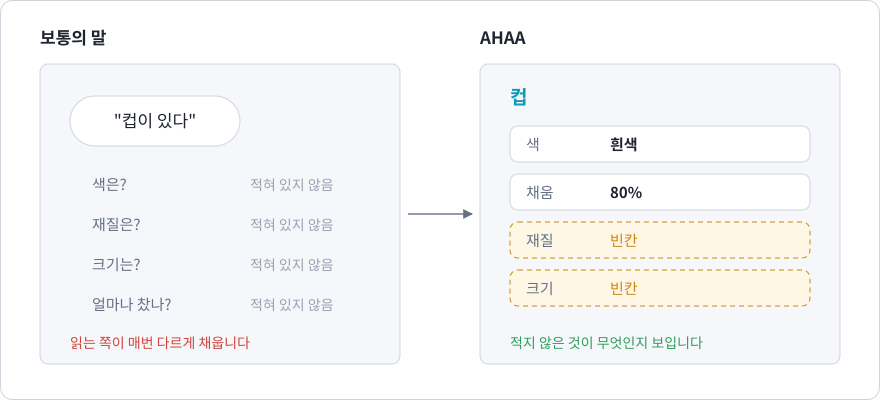

"컵이 있다"라는 말에는 컵의 색도, 재질도, 크기도 없습니다. 사람끼리는 맥락으로 채우지만, 그림을 그리는 AI는 적히지 않은 부분을 매번 다르게 지어냅니다. 더 큰 문제는 쓰는 사람도 **무엇을 빠뜨렸는지 모르고 지나간다**는 것입니다.

AHAA에서 낱말은 이름표 하나가 아니라 **차원의 묶음**입니다. 값을 적지 않은 차원은 사라지지 않고 **빈칸**으로 남아 눈에 보입니다.

## 2. 낱말을 정의한다

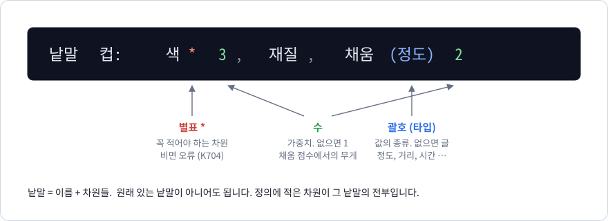

```text
낱말 컵: 색* 3, 재질, 채움(정도) 2
```

| 표기 | 뜻 |
| --- | --- |
| `색*` | 꼭 적어야 하는 차원. 비면 오류입니다. |
| `색 3` | 가중치. 이 차원이 얼마나 중요한지. 적지 않으면 1입니다. |
| `채움(정도)` | 값의 타입. 정도, 거리, 시간 등. 적지 않으면 글입니다. |

원래 있는 낱말이 아니어도 됩니다. 정의에 적은 차원이 그 낱말의 전부입니다.

## 3. 장면을 적는다

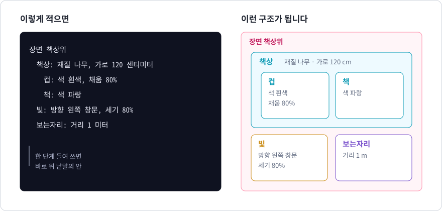

```text
장면 책상위
  책상: 재질 나무, 가로 120 센티미터
    컵: 색 흰색, 채움 80%
    책: 색 파랑
  빛: 방향 왼쪽 창문, 세기 80%
  보는자리: 거리 1 미터
```

한 단계 들여 쓴 줄은 바로 위 낱말의 **안에** 있습니다. `컵`과 `책`은 `책상` 안에 있습니다. `빛`, `보는자리`, `배경`, `날씨`는 미리 정의되어 있어 바로 씁니다.

## 4. HTML에서 본뜬 것과 더한 것

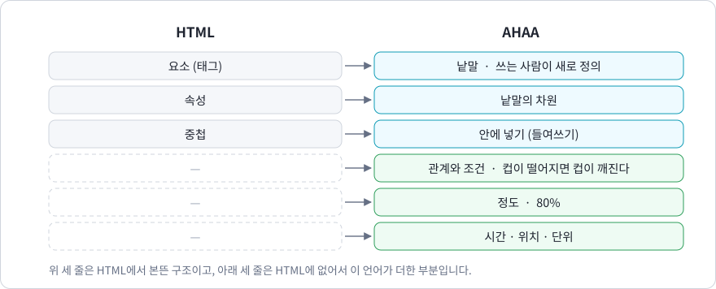

구조는 HTML에서 본떴습니다. HTML은 "무엇이 무엇 안에 있다"까지만 적습니다. AHAA는 거기에 관계와 조건, 정도, 시간·위치·단위를 더합니다.

```text
행위 떨어지다, 깨지다: 주체
컵이 70% 떨어졌다
컵이 떨어지면 컵이 80% 깨진다
```

## 5. 빈칸과 채움 점수

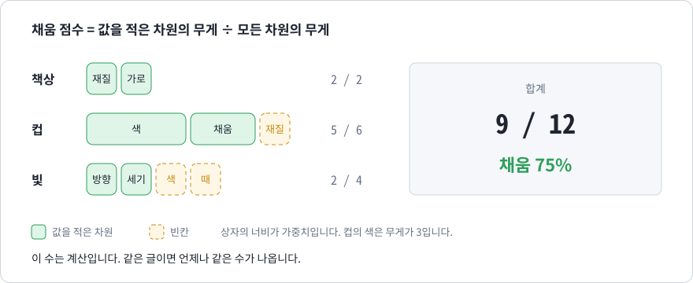

컴파일러는 장면마다 빈칸의 목록과 **채움 점수**를 냅니다.

```text
장면 '책상위': 낱말 3개, 채움 75% (빈칸 3개: 컵.재질, 빛.색, 빛.때)
```

- 채움 점수는 값을 적은 차원의 가중치 합을 모든 차원의 가중치 합으로 나눈 값입니다.
- 계산이므로 같은 글이면 언제나 같은 수가 나옵니다.
- 빈칸은 오류가 아닙니다. 무엇을 적지 않았는지 알고, 적을지 말지를 정하면 됩니다.

이 점수는 "선언한 차원을 얼마나 채웠는가"이지 "장면을 얼마나 잘 적었는가"가 아닙니다. 차원을 둘만 선언하고 둘 다 채우면 100%입니다.

## 6. 연결망: 글이 그물이 된다

적은 것은 점이 되고, 그 사이의 관계는 선이 됩니다. `aha 그래프 파일.aha`로 만듭니다.

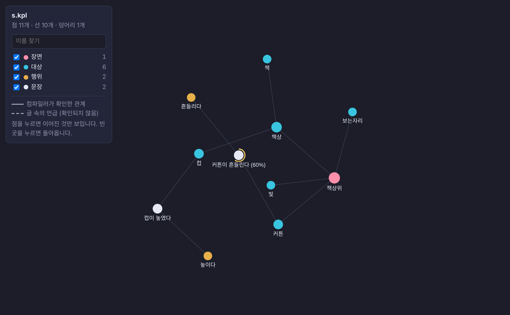

정도를 적은 문장은 둘레에 호가 그려집니다. 조건문을 따라 정도가 전해지는 길이 선으로 이어집니다.

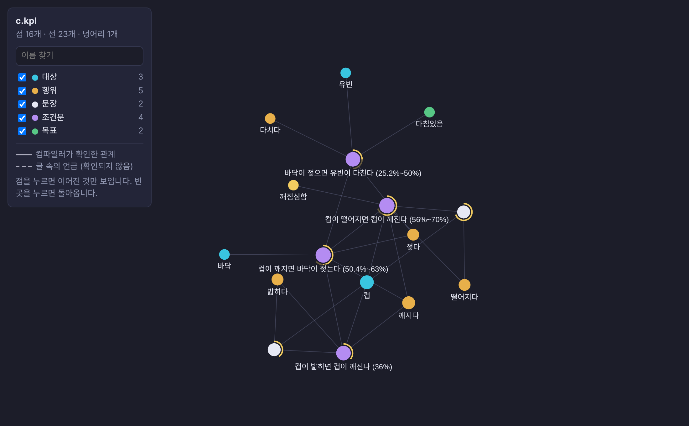

점을 누르면 그 점과 이어진 것만 남고, 오른쪽에 관계의 목록이 나옵니다.

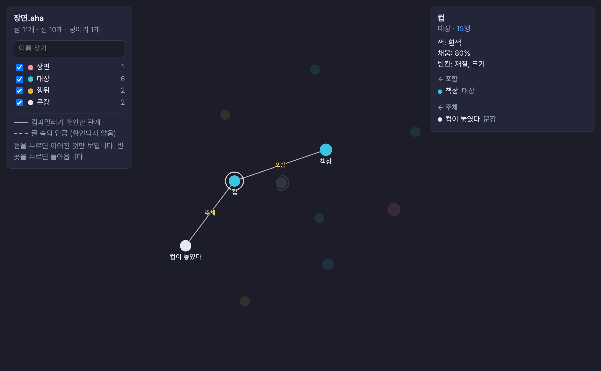

- **실선**은 컴파일러가 문법으로 확인한 관계입니다.
- **점선**은 자유로운 글에 선언한 이름이 나온 자리입니다. 글의 뜻을 확인한 것은 아닙니다.
- 서로 이어지지 않은 부분이 있으면 "떨어진 덩어리"로 알려 줍니다.

## 7. 두 가지 검사

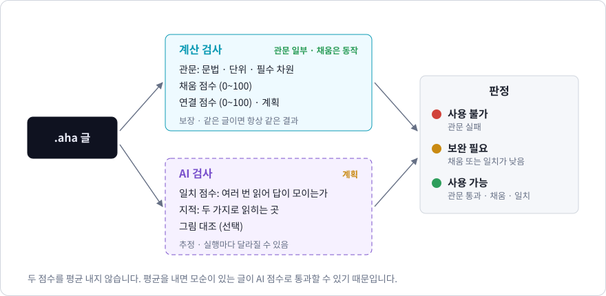

| | 계산 검사 | AI 검사 |
| --- | --- | --- |
| 하는 일 | 문법, 단위, 필수 차원, 빈칸, 채움 점수 | 글을 여러 번 읽어 해석이 한 가지로 모이는지 확인 |
| 결과 | 보장. 같은 글이면 항상 같음 | 추정. 실행마다 달라질 수 있음 |
| 상태 | **지금 동작** (위치의 모순 검사와 연결 점수는 계획) | **계획** |

두 점수는 평균 내지 않습니다. 평균을 내면 모순이 있는 글이 AI 점수가 높다는 이유로 통과할 수 있기 때문입니다. 계산 검사의 오류가 하나라도 있으면 점수와 상관없이 사용 불가입니다.

## 8. 세 가지 수

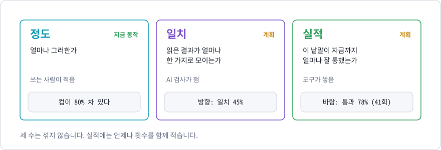

AHAA는 수가 붙어 다니는 언어입니다. 뜻이 다른 세 가지 수를 섞지 않습니다.

| 수 | 뜻 | 누가 정하는가 | 상태 |
| --- | --- | --- | --- |
| 정도 | 얼마나 그러한가 | 쓰는 사람이 적음 | 지금 동작 |
| 일치 | 읽은 결과가 얼마나 한 가지로 모이는가 | AI 검사가 잼 | 계획 |
| 실적 | 이 낱말이 지금까지 얼마나 잘 통했는가 | 도구가 검사 기록에서 쌓음 | 계획 |

실적은 사람이 적지 않으며, 언제나 횟수와 함께 보여 줍니다. 검사를 돌린 만큼만 생기므로 처음에는 비어 있습니다.

## 9. 어디까지 만들었나

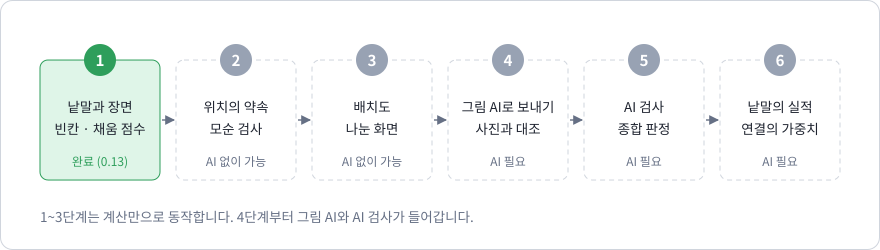

| 단계 | 내용 | 상태 |
| --- | --- | --- |
| 1 | 낱말과 장면, 빈칸과 채움 점수 | 완료 (0.13) |
| 2 | 낱말끼리의 위치를 적는 약속과 모순 검사 | 계획 |
| 3 | 글을 쓰면 오른쪽에 배치도가 나오는 화면 | 계획 |
| 4 | 그림 AI로 보내기, 실제 사진과 대조 | 계획 |
| 5 | AI 검사와 종합 판정 | 계획 |
| 6 | 낱말의 실적 통계와 연결의 가중치 | 계획 |

완성도의 기준은 하나입니다. **보이는 장면을 이 언어로 적고, 그 글만으로 그림 AI가 그린 그림이 원래 장면과 얼마나 비슷한가.** 4단계에서 처음으로 이 기준을 잽니다.

## 10. 써 보기

Rust가 필요합니다. Windows PowerShell 기준입니다.

```powershell
git clone https://github.com/kimyubin33/relspec-lang.git
cd relspec-lang
cargo build --release
.\target\release\aha.exe 검사 examples\장면.aha
.\target\release\aha.exe 그래프 examples\장면.aha
```

첫 명령은 빈칸과 채움 점수를 보여 주고, 둘째 명령은 연결망을 `examples\장면.그래프.html`로 만듭니다. 그 파일을 브라우저로 열면 됩니다.

VS Code에서 색칠과 실시간 검사를 쓰려면 [확장 설치 안내](../editors/vscode/README.md)를 따르세요.

## 알아 둘 한계

- 글에는 사진만큼의 정보가 들어가지 않습니다. 목표는 "같은 장면이라고 알아볼 수 있다"이며, 완벽한 재현이 아닙니다.
- 타입이 없는 차원의 값은 글이며, 컴파일러는 그 글의 뜻을 확인하지 않습니다. `색 흰색`과 `색 하양`이 같은지 모릅니다.
- 가중치는 지금은 쓰는 사람이 정한 값이고, 잰 값이 아닙니다.
- AI가 들어가는 부분(그림, AI 검사, 실적)은 아직 만들지 않았습니다.
